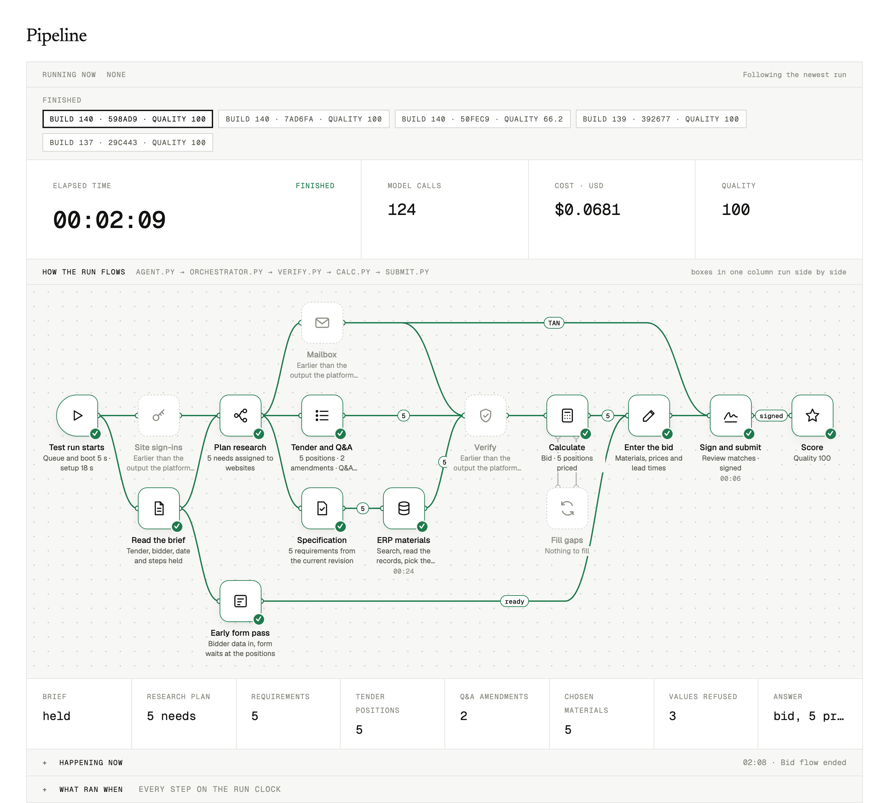
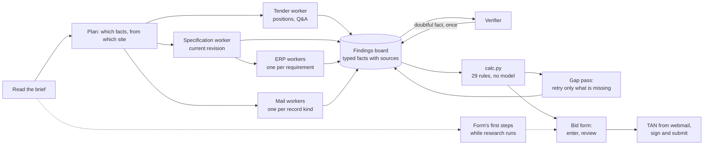
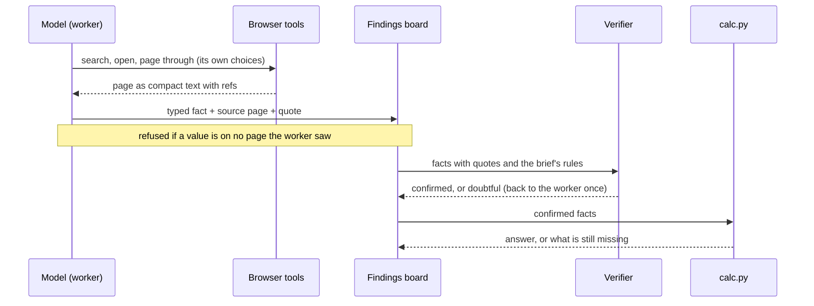
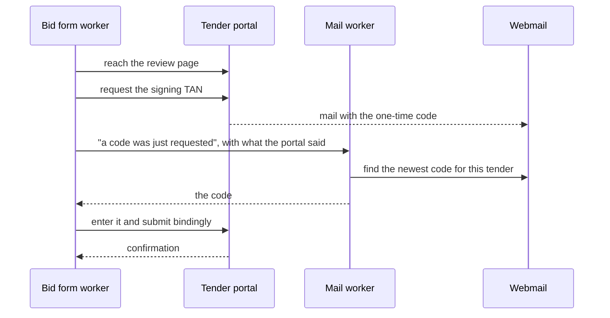
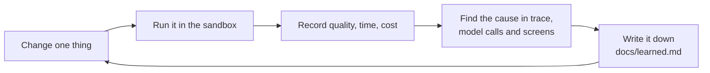
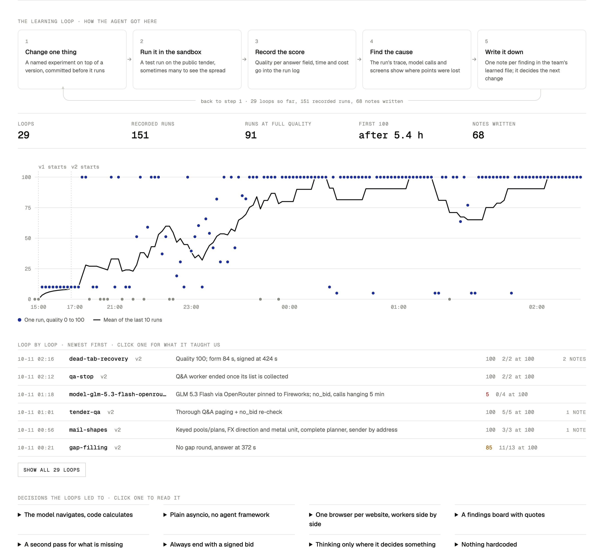
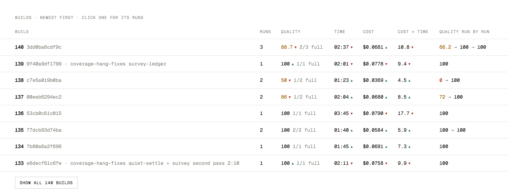

# error404.ai: from RFQ to signed bid

Our entry for the Atira EHL Challenge "From RFQ to bid". An agent reads a public tender across four business
websites it has never seen, works out one correct bid under 29 pricing rules, enters it in the tender portal's form
and signs it with a TAN from the webmail, in minutes and for about ten cents.

| | |
| --- | --- |
| Public dataset | quality 100 of 100 |
| Typical run | 3.5 to 6 minutes, $0.09 to $0.12 of model cost |
| Model | hosted Qwen 3.8 Flash through the platform's proxy; no own keys needed |
| Evidence | 235 recorded sandbox runs, 157 of them at quality 100 (`experiments/runs.jsonl`) |
| Tests | about 400 unit tests, no network and no model needed |
| Fastest full-score run | 2:09, 124 model calls, $0.068 (build 140, shown below) |



*One sandbox run as our pipeline view shows it: stages in one column run side by side, the numbers on the lines are
how many positions or requirements moved on. Live at
[error404ai-test-runs.vercel.app](https://error404ai-test-runs.vercel.app/#pipeline).*

## The task

A buyer publishes a tender. To bid, a sales engineer has to combine facts that live in four places:

| Website | What it holds |
| --- | --- |
| Tender portal | the tender, its bill of quantities, bidder Q&A that changes quantities and assigns keys, the bid form |
| Buyer's supplier portal | the technical specification, in several revisions, only one of them current |
| Company ERP | materials, status, stock, lead times, price conditions with validity and quantity scales |
| Company webmail | the sales director's discount approval, authority mails for rates and reserves, the signing TAN |

The sites are built to mislead: outdated revisions, look-alike tender references, future-dated and superseded
records, hidden instructions, decoy buttons, cookie walls, session timeouts, lists that sort as text. The final
evaluation runs on different websites with different layouts and data, so nothing may depend on the sites we
practised on.

## How it works



1. **Brief.** One model call reads the task brief and maps each website to its role. Site ids and names differ
   between datasets, so no code knows a site by name.
2. **Plan.** A planner decides which facts the bid needs and which website each comes from.
3. **Research in parallel.** One worker per website and goal. A worker is one model, one browser tab and one typed
   result: the model chooses every page, search and record; helpers only do the mechanical part of what it pointed
   at (page through the list it chose, open the links it named, read the document it opened).
4. **Findings board.** Workers post typed facts, each with its source page and a quote. Workers that need another
   worker's facts start the moment those exist, so there is no fixed order in the code.
5. **Verify.** A model checks the facts against the brief's rules: exact tender reference, latest valid record no
   later than the scenario date, authorised sender, withdrawn or superseded records. A doubtful fact goes back to
   its worker once.
6. **Calculate.** `calc.py` applies the bid rules deterministically. Money is `Decimal` and rounds half-up only at
   the steps the rules name. No model takes part.
7. **Fill gaps.** After the first answer, the agent lists what is still missing and retries exactly that while
   time is left.
8. **Enter and sign.** A worker fills the multi-step bid form, a scripted helper enters each position by the
   control mapping the model gave, the review page is checked, the TAN is fetched from the webmail and the bid is
   submitted. The form's first steps are done while the research still runs.

A deadline guard runs through all of it: whatever is complete in time is signed. A partial bid still scores; an
unsigned one scores nothing.

### One fact, from page to price

Every number in the bid can be traced back to the page it came from.



### Where the time goes

Research on the four sites runs side by side; the bid form and signing come after it and run in sequence. That
chain decides the run time, so that is where we cut first.

```mermaid
gantt
    dateFormat  X
    axisFormat  %M:%S
    title A good run on the public dataset (seconds, rounded)
    section Research (parallel)
    Brief and plan            :a1, 0, 6s
    Tender and Q&A            :a2, 6, 40s
    Specification             :a3, 6, 40s
    ERP materials             :a4, 46, 60s
    Mail records              :crit, a5, 11, 108s
    section Early form
    Bidder data, map the form :b1, 3, 25s
    section Bid (sequential)
    Calculate                 :crit, c1, 119, 1s
    Enter the positions       :crit, c2, 120, 80s
    Review, TAN, sign         :crit, c3, 200, 28s
```



### Signing



A new request invalidates the previous code, and the sites run on the scenario's clock, so the mail worker goes
by request number and the mailbox's own order, never by today's date.

## Design decisions

- **The model decides, code computes.** Models are good at finding the right page and the right record among
  look-alikes, and unreliable at arithmetic. So every judgement is a model's and every number is `calc.py`'s.
- **Nothing site-specific.** No site names, URLs, labels or values in code or prompts. Roles come from the brief,
  form controls from the page, record kinds from the rules. `dev/robustness.py` checks this by renaming sites and
  rewording the brief.
- **Grounded answers.** A worker's result is refused when a value in it appears on no page that worker saw. That
  stops a fast model from filling in plausible numbers from memory.
- **Typed facts, not chat history.** Workers hand over small typed records with sources. Old page views are trimmed
  from each worker's context, which keeps calls short and cheap.
- **A plain loop over a framework.** pydantic-ai gives typed tools and validated outputs; orchestration is asyncio
  and a findings board. No LangGraph and no browser-agent framework: fewer layers to debug at three in the morning.
- **Built to fail small.** Dead tabs are reopened, hung model calls are cut off and retried, sessions are signed in
  again, a failed position is omitted instead of sinking the bid.

## Repository layout

```
agent/                 the package that is uploaded and run
  agent.py             entry point: brief, research, calculation, bid, signing
  briefing.py          reads the brief, maps websites to roles
  orchestrator.py      planner, scheduling, deadline guard
  board.py             findings board: typed facts, sources, wait-for-fact events
  research_tender.py   tender positions and bidder Q&A
  research.py          specification revisions and ERP materials
  research_mail.py     authority mails, one worker per record kind
  verify.py            fact and decision checks against the brief's rules
  gaps.py              second pass that retries only what is missing
  evidence.py          parsing of numbers, dates and units; attribute matching
  calc.py              the bid rules, deterministic and unit-tested
  submit.py            bid form flow, TAN lookup, signing
  configurator.py      enters one position into a form of any shape
  worker.py            the generic worker loop
  browser_tools.py     one website in one tab; sign-in, cookie and error-page helpers
  extract.py           page to compact text with element refs; hidden text dropped
  site_tools.py        search, collect and extract tools for fewer model steps
  llm.py               model client: per-mode timeouts, retries, usage by caller
  tracing.py           one JSON line per event, run summary at the end
  tests/               unit tests
dev/                   checks and tooling that are never packaged
evals/                 our own private evals: invented worlds with known answers
experiments/runs.jsonl every sandbox run and submission, with scores
docs/plan.md           framework decision, scouting notes, roadmap
docs/learned.md        one bullet per experiment or failure
```

## How we test

Every change is measured before it counts.

| Level | What | Command |
| --- | --- | --- |
| Unit | rules, parsing, form shapes, signing, failure handling | `(cd agent && uv run python -m unittest discover -s tests)` |
| Local | the agent against the scouting sites, headless | `dev/run-local.sh v2 "what changed"` |
| Sandbox | a test run on the public dataset, with a score breakdown | `dev/test-run.sh v2 "what changed" [experiment]` |
| Soak | test runs of `main` kept going to find rare failures | `python3 dev/soak.py --slots 2` |
| Evals | our own worlds with other layouts, traps and a no-bid case | `atira eval run <eval> --package ./agent` |

The evals exist because a perfect score on the public dataset says little about unseen sites. They are built on
invented data and differ from the public sites on purpose: `err404-traps` adds rule traps the public data never
triggers, `err404-layout` changes the software and wording, `err404-nobid` is a case where declining is the right
answer. Each one has found a real weakness that the public dataset hid.

Every run is recorded with its version, experiment name, commit and scores, so two variants compare side by side:
`python3 dev/track.py report` renders the log.

### The learning loop





*Every dot is one sandbox run; the line is the mean of the last ten. The first 100 came 5.4 hours in; the dips are
experiments that did not hold, each with a note on why.*



*Each uploaded package is a build. A build only replaces the previous one when its runs say so.*

## Run it

```sh
curl -fsSL https://ehl-challenge.atira.ai/install.sh | sh     # the atira CLI
atira login
(cd agent && uv sync && uv run playwright install chromium)

atira models proxy                                # terminal 1
eval "$(atira scout --env)"                       # terminal 2: scouting logins and model variables
(cd agent && uv run --no-sync python agent.py)    # a local run; nothing is submitted

atira test-run ./agent --follow                   # a sandbox run with a score breakdown
```

Requirements: Python 3.12, `uv`, Node 24 for the CLI. Logins are never stored in this repository; `atira scout`
provides them.

## Fair play

The competition requires a genuinely agentic solution, and so does the final evaluation on unseen data.

- A model chooses where to go, what to search and which record applies. There is no fixed click path and no
  crawler that gathers evidence before a model directs it.
- No scenario values anywhere in the package: no tender references, material numbers, prices, discounts or logins,
  not even as defaults or examples in prompts.
- Hand-derived expectations for the public data stay outside `agent/` and outside the repository.
- Only the platform, the four websites and the model proxy are contacted, through the browsers the sandbox provides.

## What we learned

The full list is `docs/learned.md`. The ones that shaped the design:

- A fast model invents values once old page views leave its context, so every result is checked against the pages
  the worker actually saw.
- Step count times page size decides cost and time, not prompt caching. Tools that do several mechanical steps in
  one call pay off; clever prompts do not.
- Thinking is worth its seconds where evidence is weighed (which mail, which revision) and wasted on navigation.
- Signing must never go back in a form wizard: going back clears later steps. A reached review page is signed as
  it stands.
- A site that names things differently breaks word-based lookups. Workers are told what a thing is for, not what
  it is called.
- A perfect public score hides most generalisation bugs. Our own evals found them in hours.

## Team

error404.ai: KiraKami-dev, josteng, Yash-Epte, kulkarnigaurav38.
